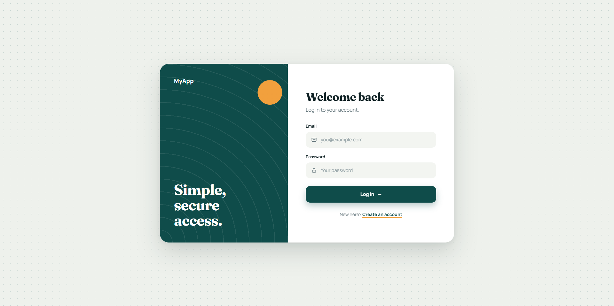
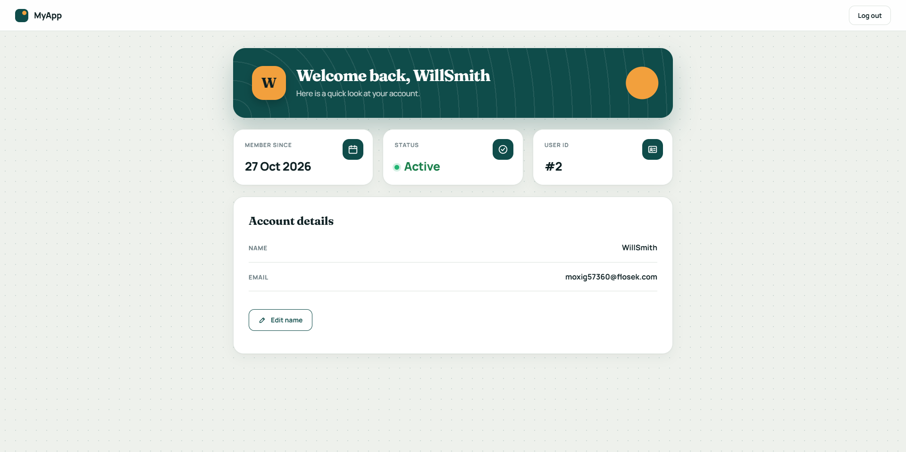

# Secure Login System (PHP + MySQL)

A registration and login system with a private dashboard, built with PHP and MySQL. It focuses on the basics of keeping user accounts safe.

Live site: https://ordinaryphantom-lgtm.github.io/secure-login-php/




## Features

- Register with name, email and password (with checks for matching passwords and a minimum length)
- Log in and log out
- A dashboard that only logged-in users can open
- Edit your own name

## Security

- Passwords are hashed with `password_hash` and checked with `password_verify`, so real passwords are never stored
- Every database query uses prepared statements, which protects against SQL injection
- User text is printed with `htmlspecialchars`, which protects against XSS (user text running as code in other people's browsers)
- The session ID is renewed at login (`session_regenerate_id`)
- Wrong email and wrong password show the same message, so nobody can find out which emails are registered
- The logged-in user always comes from the session, never from the URL or a form

## Built with

- PHP (mysqli)
- MySQL
- HTML and CSS
- XAMPP for running it locally

## Run it on your computer

1. Install [XAMPP](https://www.apachefriends.org/) and start **Apache** and **MySQL**
2. Put this folder inside `C:\xampp\htdocs\` and name it `secure-login-php`
3. Open `http://localhost/phpmyadmin` and create a database called `secure_login`
4. Open the **SQL** tab of that database and run:

```sql
CREATE TABLE users (
  id INT AUTO_INCREMENT PRIMARY KEY,
  name VARCHAR(100) NOT NULL,
  email VARCHAR(100) NOT NULL UNIQUE,
  password VARCHAR(255) NOT NULL,
  created_at TIMESTAMP DEFAULT CURRENT_TIMESTAMP
);
```

5. Open `db.php` and check that the database name is `secure_login`
6. Go to `http://localhost/secure-login-php/register.php`

`db.php` uses XAMPP's default local settings (user `root`, no password). Never upload real passwords to GitHub.

## Files

| File | What it does |
|---|---|
| `db.php` | Connects to the database |
| `register.php` | Creates an account |
| `login.php` | Logs a user in |
| `dashboard.php` | The private page |
| `edit-name.php` | Changes the user's name |
| `logout.php` | Ends the session |
| `style.css` | The look of all pages |

## What I would add next

- CSRF tokens on the forms
- Limits on login attempts
- Email verification and password reset

## Author

[404Architect](https://github.com/OrdinaryPhantom-lgtm)
 
